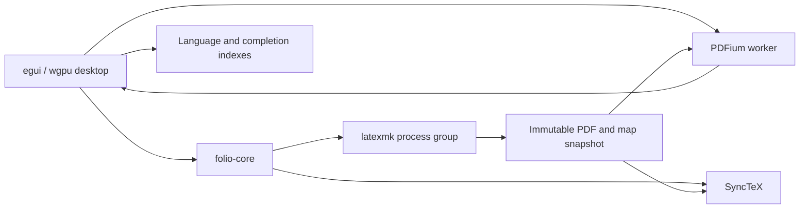

# Folio architecture

Folio is a local, project-only editor. A native window shows one source or PDF
surface at a time, with transient commands and an optional project browser.
The interface is event-driven; file scans, compilation, Git and PDF work run
outside the UI thread.

## Boundaries

The root crate owns the document/project model, builds, export, Git comparison,
SyncTeX parsing and PDF text geometry. Its only direct dependency is `toml_edit`.
The CLI uses the same project/build APIs. `desktop/` is a separate Cargo package
so core tests need no window system, GPU or native PDF runtime.

The desktop uses egui/eframe and wgpu: Metal on macOS, Vulkan or GL on Linux.
PDFium rasterizes pages on a worker; the GPU composes page textures and the UI.
This separation is deliberate and does not imply GPU PDF rasterization.

## Projects and build state

A project has `folio.project.toml`, `main.tex`, `sections/`, `figures/` and
`tables/`. Additional bibliography, styles and data directories are optional.
Core validation enforces the structure and project boundary. The manifest
chooses the main file, compiler and timeout. Global `folio.toml` supplies UI
settings and defaults for newly created projects.

Source buffers retain revisions, selections, scroll offsets and disk stamps.
Atomic saves detect external edits rather than silently overwriting them.
Switching projects checks unsaved buffers. Background inventory snapshots use
project generation and document revision checks to reject obsolete results.

Entering a stale PDF saves source buffers and queues a build. One build runs at
a time. Managed builds invoke `latexmk -norc` without shell escape, with SyncTeX
and file/line diagnostics. Cancellation terminates the process group with a
short grace period; interrupted auxiliary output is cleaned before another
attempt. Successful builds publish immutable PDF/map pairs under `.folio/`.
A failed build preserves the last successful preview and does not continually
retry the same failed revision.

Flat export snapshots a validated, saved project, compiles it, uses `latexpand`
to expand includes, rewrites asset paths, handles the chosen bibliography mode,
and recompiles the result before publishing a new destination. Sections and
tables enter `main.tex`; figures are placed beside it. Staging failures leave
authoring files and existing destinations intact.

## Editing and input

LaTeX uses incremental Tree-sitter parsing and a lossless coloring lexer. TOML
and JSON use small lexers that tolerate partial edits. Syntax, bracket pairs,
paragraph/sentence ranges and completion indexes refresh on text changes;
caret movement reuses them. Bibliography and project inventory scans run in the
background; unsaved buffers overlay those indexes.

Bracket indexes use Unicode character offsets compatible with egui. They skip
strings, comments and raw regions. Prose motions reuse syntax tokens to avoid
sentence boundaries inside commands, math or verbatim and use punctuation
heuristics rather than TeX expansion.

Settings define application commands and mouse gestures. Conflict validation
accounts for active contexts. Source motions require editor focus; search,
launchers, confirmation dialogs and PDF preserve their input. PDF fit gestures
have a dedicated recognizer: a single tap acts immediately, a second released
tap within 350 ms selects whole-page fit, and intervening actions reset the
sequence. Native copy/paste, undo and platform dialogs retain platform bindings.

## Preview and navigation

One PDFium worker owns native document access. Viewport requests replace obsolete
render work. Visible pages get drafts first and sharpen after interaction settles;
adjacent pages are prefetched. The UI uploads at most one completed image per
frame. Render resolution respects the texture budget and GPU limits, and text
indexing is independent of page textures. A failed page does not freeze the rest.

Layout uses the actual canvas after panels claim their space. Default width fit
uses 90% of that width. Whole-page fit additionally caps height. Manual zoom
preserves the point under the pointer; fitting and resize rules retain the
current page. Width entry and overview-to-width transitions show a tall page's
beginning unless an explicit search or SyncTeX target takes precedence.

SyncTeX locates the source line or PDF region in the displayed build snapshot.
Inverse navigation then matches the selected PDF word in nearby source using
context, with Unicode/ligature and line-wrap handling. Ambiguous/generated text
falls back to the mapped line. Search normalizes whitespace while preserving
character-to-geometry correspondence.

Git comparison runs separately after a typing pause. It resolves a commit,
reads that file's blob and uses Git's diff against the current buffer. Generation
checks discard stale results. The feature only reads the repository; it does not
stage, commit or check out files.

## Compatibility and verification

`desktop/native/latex_scanner.c` supplies the external scanner missing from the
pinned `tree-sitter-latex` crate. The macOS `block` dependency has a narrow local
patch with [provenance and runtime tests](../vendor/block/PATCH.md). Neither
workaround modifies Cargo's registry cache or suppresses compiler warnings.

Tests cover core contracts, real egui input/layout frames, native block callbacks,
and optional TeX/PDF integrations. See [Contributing](../CONTRIBUTING.md) for the
TDD workflow and commands, and [validation](validation.md) for observed results.
Detailed historical decisions remain in [design history](design-history.md);
older entries may describe replaced interfaces.
