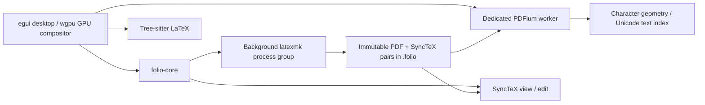

# Design history

Historical decisions in implementation order. See [architecture.md](architecture.md)
for the current system; older entries describe interfaces that have since changed.

## Prose navigation (v0.9.4)

`language/motion.rs` builds paragraph and sentence ranges in Unicode character
offsets alongside the existing syntax/bracket cache. It reuses the lossless
highlighting tokens to distinguish actual `\par` commands and ignore sentence
punctuation in comments, math, verbatim and command tokens. Blank lines delimit
source paragraphs, and lightweight punctuation/abbreviation heuristics delimit
sentences. Index construction happens on text changes; unchanged source reuses
the cache, and boundary lookup uses binary search. No new dependencies or mode
state are needed.

Four configurable source actions use `Primary+D/U/J/K` by default. Forward
motions find the current/next end; backward motions find the current/previous
start. The shortcut dispatcher requires editor focus and no confirmation/native
dialog; explicit command-palette invocation can restore source focus. A motion
sets a collapsed pending caret jump, dismisses completion and invalidates stale
asynchronous Go results, without editing, saving or invalidating the PDF.
Motion jumps reveal only offscreen destinations, while existing Find/SyncTeX
jumps keep their centered positioning.

## Source languages and bracket matching (v0.9.3)

Each source surface chooses its language from its file extension. LaTeX keeps
its incremental Tree-sitter parser and existing lexer. TOML and JSON use small,
lossless lexers that handle partial edits without requiring a successful parse;
other text stays plain. Coloring supports quoted/dotted keys, nested containers,
TOML tables, multiline/basic/literal strings, comments, numeric/date values and
JSON literals. Configuration surfaces do not run the LaTeX parser, contribute
false outline/label entries, or open LaTeX completion menus. JSON joins the
background inventory used by the surface switcher. No new dependencies are needed.

The language cache builds an ordered bracket index alongside syntax colors on
text changes. Entries store egui character offsets and partner indices, avoiding
UTF-8 byte/character confusion. Strings, comments and raw LaTeX regions are
excluded; math groups and escaped math delimiters remain matchable. Malformed
nesting cannot create crossing pairs. Caret movement performs a binary search
and paints at most two outlines from the actual text galley, clipped to the
editor viewport. Syntax layout does not depend on the caret, and selection or
loss of editor focus hides bracket outlines.

## PDF fitting and keyboard gestures (v0.9.5)

A successful source-to-PDF transition activates the configured fitting policy:
width by default, whole page, or keep the previous zoom. Activation records intent
and the current page; it does not measure the source surface or trigger rendering
or compilation. The preview computes scale from its actual remaining canvas after
the browser, caption, search row and compiler panel have claimed their space.

One page-scale function serves layout and pointer zoom. Width is the actual
canvas width times the configurable `width_fraction` (default 0.9). The layout
cache includes both viewport dimensions, this fraction and the fitting mode.
Whole-page fitting additionally caps height with vertical margins, so switching
from width to page never enlarges a page. Page fit recenters the current page
after resizing and handles mixed page sizes and delayed metadata. Width-mode
entry, page navigation and returning from the whole-page overview start at the
top of tall pages; explicit search or
SyncTeX destinations still center their text target. Page-mode SyncTeX keeps
the destination's entire page visible and draws the existing highlight. Manual
zoom leaves automatic fitting until the next transition. Builds or repeated PDF
focus commands while already in PDF do not reactivate fitting. Texture caching
and asynchronous refinement remain in place.

`preview/fit_keys.rs` recognizes the configurable `pdf_fit` and `pdf_fit_page`
chords in input order. Space fits width immediately; a second released press
within 350 ms selects page fitting. A completed pair resets; holding a key does
not complete a pair. Other commands, pointer gestures, context changes and window
focus loss cancel a pending pair. The dispatcher only enables fitting gestures
in PDF with no text input or modal focus. Repeated chords (`Space Space`, `F7 F7`)
are supported for these two actions; ordinary single chords remain available.
Conflict validation permits their single/double prefix but rejects ambiguous
overlaps with other commands. The generic action loop leaves both fitting keys
to this handler; explicit palette actions use the same preview commands.

## Native dependency compatibility (v0.9.1)

The pinned Metal backend depends on `block` 0.1.6. A local Cargo patch in
`vendor/block` corrects its uninhabited foreign static and makes its existing C
ABI explicit. The public API and block memory layout stay unchanged; no Cargo
cache edits or compiler-warning suppressions are needed. The patch's provenance,
scope and removal condition are recorded in `vendor/block/PATCH.md`. Desktop
checks compile this dependency with future incompatibilities denied and exercise
macOS callback invocation, copying and destruction. Linux does not depend on it.

## Native visual system (v0.9)

The UI keeps egui/wgpu and the existing asynchronous build/PDF pipeline. A small
theme module owns typography, neutral surfaces, spacing and shared row drawing.
Platform fonts load once with bundled fallbacks; decoration needs no webview,
network, image assets, blur or continuous animation. Source line height and the
Git/line-number gutter share one metric.

A quiet, draggable caption identifies the project and active surface. Source and
PDF have no permanent action buttons. The project browser is a compact optional
surface, reachable through its configured shortcut or the right-click command
palette; its creation/import actions move to a context menu. Commands, files and
outline share one searchable overlay with full-width rows, aligned shortcuts
and virtualized results. Welcome actions remain clickable text rows.

Interaction regressions precede changes: button-free writing with retained line
numbers, browser access/focus, and full-row palette selection. Existing source,
PDF, search and project-switch tests guard focus and navigation. Native visual QA
checks the actual packaged app after the shared theme and layout changes.

## Project-only workspaces (v0.8)

New/Open always create or select a project. Startup and CLI build inputs require
a project folder or `folio.project.toml`; a standalone source cannot establish
a workspace. The manifest supplies every build's main file, engine and timeout.
Application build defaults seed new manifests only. Within an open project,
the browser/switcher open source buffers through a separate path that checks the
canonical project boundary, including navigation and symlink targets.

Cmd/Ctrl+N creates a project, Cmd/Ctrl+O opens one, and Cmd/Ctrl+Shift+N adds a
project file. Legacy `new`/`open` settings migrate to the corresponding project
actions. Loose-file dialogs, main-file selection and ad-hoc engine overrides are
removed. Existing projects retain their unsaved-buffer switch guard and flat
export. Regression tests precede changes to startup refusal, source boundaries,
welcome controls, shortcut migration and the command-line build contract.

## Project file browser (v0.7.1)

A collapsible sidebar exposes the current project's real folders and files.
The editor's Files button and the configurable `project_files` action toggle it;
the normal writing surface keeps its line-number gutter. Source files reuse the
existing buffer-opening path, so switching files preserves unsaved edits. Figure
assets open in the operating system's default viewer.

Directory inventory and sorting belong to the existing background project scan,
not the frame thread. The browser retains folder expansion across scans, reveals
the active source when switching buffers, and virtualizes visible rows. Inventory
stays within the project directory, skips symlinks and generated/internal folders,
and includes empty folders. A project switch clears the previous inventory.
Regression tests cover inventory boundaries, expansion, configurable access,
single-click opening, dirty-buffer preservation, and project switching before
implementation.

## Structured projects and flat export (v0.7)

Managed Folio projects use ordinary files with an authoritative
`folio.project.toml`. Schema version 1 fixes `main.tex` at the root, with
`sections/`, `figures/` and `tables/`; optional `styles/`, `data/` and
`bibliography/` contain supporting resources. `references.bib` and `preamble.tex`
may live at the root. Validation reports misplaced source/assets, missing layout
directories, symlinks and unknown manifest keys. The v0.8 workspace contract
above replaces the original loose-file compatibility path.

The core owns project creation, discovery, validation and build configuration.
Both desktop and CLI read the same manifest (engine and timeout); application
keybindings remain in the external settings TOML. Main-file guessing and engine
overrides do not supersede a managed project's manifest. New/Open project,
Validate project and Export flat are transient command-palette actions.
Project switches check unsaved buffers and invalidate old scans/navigation.

Export snapshots project files into staging, builds that copy, expands includes
using TeX Live's `latexpand`, and rewrites supported literal resource paths into
a flat directory. Protected comments/verbatim are preserved; cyclic, dynamic or
unsupported include constructs produce explicit errors. Resource names are
deterministic and collision-safe. Sections and tables enter `main.tex`; figures
stay at the export root. Bibliography mode either retains `.bib` resources or
embeds the compiled bibliography (BibLaTeX data uses `filecontents*`). A second build validates the exported source
before publishing it to a new destination. Cancellation/failure removes staging
and never modifies authoring sources. The export is a conventional LaTeX project
that works without Folio's manifest. CLI and UI share this pipeline.

Tests precede implementation: manifest validation/discovery, strict layout and
non-destructive creation; include expansion/protected text, resource collisions,
failure cleanup and destination refusal; real TeX builds and exported PDF content;
desktop project switching, build settings and action routing. Existing navigation,
Git and rendering regressions remain required.

## Word-level inverse navigation (v0.6.2)

PDF navigation retains the clicked word and a bounded context of neighboring
words alongside the SyncTeX page coordinate. SyncTeX chooses the source file and
approximate line; a pure core matcher refines that anchor to a Unicode character
range in nearby source text, ignoring command names, comments and metadata keys.
Context distinguishes repeated words, and PDF ligatures and line-end hyphenation
are normalized without losing their original glyph ranges.

Plain clicks select a PDF word. The configured mouse Go gesture targets the word
under the pointer; keyboard Go uses the current selection. Source refinement runs
against the opened buffer, after the existing asynchronous navigation token check.
An ambiguous or generated word falls back to a caret on the SyncTeX line rather
than falsely claiming an exact match. No new permanent UI or per-frame indexing
is needed. Regression tests cover the pure matcher, pointer routing, and a real
TeX/PDFium/SyncTeX round trip before packaging.

## Reliability audit design (v0.6.1)

Regression tests precede changes to the reported failure paths. PDF geometry is
invalidated with each document generation; anchors cannot outlive that geometry.
Worker failures carry their operation so a failed page or replacement document
does not stop unrelated rendering. Viewport requests divide the texture budget
among the resident pages, replacing obsolete resolutions instead of accumulating
them. Text search keeps a mapping from normalized characters to original glyphs.

Build supervision gives the process group a termination grace period and marks
interrupted auxiliary output for cleanup before reuse. Successful PDFs do not
depend on the presence of a SyncTeX map; compressed and uncompressed maps are
optional snapshot companions. Logs are decoded lossily, while editable source
files retain strict UTF-8 to avoid silently rewriting an unknown encoding.

Completion data is indexed per source file. Disk snapshots are prepared off the
UI thread; an edit only updates that buffer's index. Queries reuse indexed project
commands, labels and bibliography entries. Settings expose build timeout, and
document navigation and line counts avoid whole-buffer temporary allocations.

Status: v0.6.0 focused workspace with switchable surfaces, 10 October 2026.

## Focused workspace (v0.6)

One native window hosts one focused surface: an open source buffer or the project's
PDF. The OS title identifies that surface and its unsaved state. Permanent app
toolbars, source tabs, status bars and PDF controls are removed. Source line
numbers are enabled by default beside the existing Git change marks, and can be
disabled through the editor settings.

A transient switcher lists open buffers, project files and the PDF. Cycling visits
open buffers and the PDF without losing editor selection/scroll or cached pages.
Direct Source/Preview commands are independent of SyncTeX Go; only entering a
stale preview saves and compiles. The existing Layers revision controller and
navigation cancellation tokens remain authoritative. A searchable command
palette exposes the removed menu actions, outline, Git comparison and PDF
controls; right-click opens that palette for mouse access. Search and compiler/Git details
appear only while requested. Build progress and failures stay visible through
transient feedback and the compiler output panel.

Workspace movement and launcher filtering are pure, tested logic. UI tests cover
keyboard dispatch, focus ownership, preserving buffers when cycling, cached
preview entry and discovery of commands without restoring permanent chrome.
Every new shortcut is an action in the external TOML registry; the platform's
application-switching shortcuts are left available to the OS.

## External settings (v0.5)

`folio.toml` is the single source of defaults for application shortcuts, navigation
and wheel gestures, engine, editor and preview preferences. Startup checks beside
the executable first, then `$HOME/.config/folio/folio.toml`. Only a missing file
falls through; malformed or unreadable configuration is reported with its path.
Partial files inherit bundled defaults, and an empty shortcut list disables an
action. Unknown settings and conflicting bindings are errors, not silent typos.

The desktop settings module parses and validates once before creating the window.
The editor and PDF layer share the resulting immutable settings; input dispatch,
the command palette and shortcut help use the same action registry. No configuration reads or
parsing occur in the rendering loop. Native text editing and file dialogs retain
their toolkit/platform behavior. Egui's implicit interface-zoom handler is
disabled and those actions join the configurable registry, so unbinding them
does not leave a second active handler. Modifier matching is exact and resolves
Primary to the host's physical Command/Control modifier. Completion and find
and launcher bindings are scoped to their active controls. Settings take effect on the next launch, and
packaging preserves an existing user-edited file. Tests first cover discovery,
overrides, invalid input and remapped events, then exercise real layer UI routing.

macOS packaging stores the TOML in `Contents/Resources` and exposes it through a
relative `Contents/MacOS/folio.toml` symlink. This retains executable-adjacent
lookup while keeping non-code data in the bundle's resource directory, as
required by [Apple's signing layout](https://developer.apple.com/library/archive/technotes/tn2206/).

## Layer workflow (v0.2)

The revision controller distinguishes Source and Preview. Source buffers occupy
individual surfaces in the v0.6 workspace; the earlier top bar and menus have been
replaced by transient launchers. The controller's build and navigation semantics
remain shared across the workspace.

Entering Preview saves changed buffers and compiles only if its revision is stale.
The revision includes edits, engine/root changes and changed project dependencies.
An unchanged PDF is reused, including its scroll position. Builds remain asynchronous;
failure retains the previous PDF and exposes diagnostics without claiming freshness.
Returning to Source while compiling does not force a later switch back to Preview.

Cmd+left-double-click (Ctrl on Linux) sends the start of the source selection
through forward SyncTeX, building first if necessary. In Preview it sends the
clicked word through inverse SyncTeX, then refines the mapped source line to the
matching word in the correct file. Keyboard Go uses the selection. Plain PDF
clicks only select a word; they do not change layers. Async navigation is
tagged so cancelled or superseded requests cannot unexpectedly switch the view.

Completion is a caret-anchored keyboard menu: arrows navigate, Tab/Enter accepts,
Escape dismisses. Commands, environments and project labels are contextual.
Project `.bib` files and BibTeX/BibLaTeX resources declared in source are indexed locally; citation
suggestions show keys with author, title and year, including unsaved bibliography
buffers. Compilation still delegates bibliography processing to latexmk.

## Product contract

A local macOS/Linux LaTeX workspace with an editable source pane, a searchable,
selectable PDF pane, and bidirectional source navigation. No service, browser
server, account, telemetry, or network request is needed at runtime. Existing TeX
distributions supply package resolution and compilation.

## Boundaries

* **Core:** Rust library with `toml_edit` for project manifests. UTF-8 offsets, disk conflict detection,
  atomic saves, syntax tokens, structural outline/completions, process supervision,
  build diagnostics, SyncTeX result parsing, PDF text geometry and bounded cache
  policy are testable without a display or native PDF library.
* **Desktop:** egui/eframe with the wgpu renderer, Metal on macOS and Vulkan/GL
  backends on Linux. Event-driven repaints, one source layout cache per open document and mutually exclusive
  Source/Preview layers. A two-second dependency scan notices external edits. Native file dialogs run off the event thread.
* **Language:** Tree-sitter handles LaTeX structure and errors; a lossless lexer
  colors commands (including unknown package macros), math, comments, delimiters,
  and verbatim. Completion includes built-ins and document labels/citations.
  This is syntax support, not a TeX macro evaluator; the selected TeX engine is
  authoritative for package semantics and compilation errors.
  The pinned `tree-sitter-latex` 0.1.0 crate omits its external scanner. A small
  stateless C compatibility scanner in `desktop/native/` supplies its public ABI.
  Regression tests cover all twelve raw-token types, incomplete input, empty
  verbatim blocks, command boundaries and incremental Unicode edits.
* **Build:** save project buffers before invoking latexmk. Use argument arrays,
  not a shell. Enable SyncTeX and file/line diagnostics. Disable shell escape by
  default. Compile at most one job at a time, support cancellation and timeout,
  preserve the last successful preview on error. Output is separate from sources.
  TeX tool directories are added to the child's PATH so Finder launches can
  resolve engines and bibliography tools without inheriting a terminal session.
* **PDF:** PDFium stays on one worker. Page textures are requested on demand at
  display density, with a bounded texture cache. Rasterization happens on CPU;
  page composition, scrolling and editor painting use the GPU. Text geometry
  is indexed independently of pixels. Search and selection operate on Unicode
  characters and their page-space rectangles.
* **Navigation:** SyncTeX is the source of truth, never text matching. UI pointer
  coordinates are transformed into top-left PDF points before inverse lookup;
  forward locations are highlighted on the requested page. A mapping refers to
  the last successful build and can be stale after an edit.

## State and failure handling

Documents retain their saved contents to detect dirty state and external changes.
Switching surfaces does not discard edits. Closing a dirty project requires an explicit
save/discard decision. Worker messages carry a generation to reject stale PDF
results. Saving uses a sibling temporary file and rename; a changed-on-disk file
is never silently overwritten. Compiler output is redirected to a file to avoid
pipe deadlocks. Project roots and paths with spaces are passed unchanged.

## Test-driven implementation sequence

1. Write failing tests for document edits/saves, syntax coverage, PDF coordinate
   and Unicode behavior, SyncTeX parsing, build arguments and diagnostics.
2. Implement the smallest passing core and refactor with the suite green.
3. Add failing integration tests against the installed TeX distribution: compile
   a multi-file fixture, query forward/inverse SyncTeX, exercise compilation failure.
4. Build the desktop adapters and verify PDF text extraction/rendering against
   the same fixture. Add unit tests around syntax parsing and cache invalidation.
5. Run format/lint/tests, desktop compilation, a GUI smoke test and platform CI.
   Record unavailable checks honestly; passing core tests do not prove GUI or
   Linux correctness.

## Deliberate limits

The first version is a practical editor, not an assertion of Overleaf feature
parity. Collaborative editing, Git write operations, rich bibliography management, arbitrary
macro semantic analysis, PDF annotation/signing, and an embedded TeX distribution
are out of scope. Large-file source layout and first-open PDF indexing require
profiling before claiming benchmarked performance. PDFium is a separately shipped
native runtime; startup reports clear installation instructions if it is missing.

## Upstream references

* https://docs.rs/eframe/0.33.3/eframe/ — native UI / wgpu renderer
* https://docs.rs/pdfium-render/0.9.4/pdfium_render/ — PDF rendering and text geometry
* https://github.com/latex-lsp/tree-sitter-latex — LaTeX grammar
* `synctex help`, `latexmk -help` from the installed TeX distribution

## Git gutter and responsive PDF pipeline (v0.3)

Git comparison is read-only: discover the repository, resolve HEAD or a chosen
commit to an object ID, read that file's committed blob, and diff it against the
current editor buffer (including unsaved changes). Git's own zero-context diff
provides hunks, so results follow Git semantics rather than a second diff engine.
A narrow gutter shows additions, modifications and deletion boundaries; clicking
a marker reveals the old/new lines. An on-demand comparison panel chooses the comparison
commit and moves between hunks. Repository discovery, blob reads and diffs run on
a debounced worker with request IDs; stale results cannot overwrite new edits.
No staging, commits, checkouts or repository writes are performed.

PDF work is scheduled for the current viewport. Visible pages get a quick draft
before full-density rendering; adjacent drafts are prefetched. New viewport
requests replace obsolete render work. Color conversion happens on the PDF
worker, and GPU uploads are paced rather than draining an arbitrary queue in one
UI frame. Page geometry is cached and only visible/nearby pages participate in
interaction/layout. Indexed text stays independent from rendered pixels and
search updates only the newly indexed page. Rebuilt PDFs retain old page textures
until replacement pixels arrive, avoiding a blank flash.

Measure first-open, dimensions, text indexing, rasterization, pixel conversion
and UI layout separately. Keep correctness tests for navigation, generations,
render scheduling/cache reuse, visible-page layout and Git hunks alongside a
reproducible release-mode benchmark. Timing results describe the measured host
and fixture; they are not universal frame-rate guarantees.

## Input latency and project scanning (v0.4)

PDF pixel deltas are consumed directly from egui's input events before laying out
and painting the current viewport. The native OS supplies trackpad momentum;
Folio does not apply egui's additional smoothing or its post-paint wheel update.
The ScrollArea still supplies clipping and draggable scroll bars. A frame token
prevents applying a gesture twice during an egui multipass frame. Pinch and
Ctrl/Command+wheel magnification preserve the PDF point under the pointer; toolbar
zoom uses the viewport center. Explicit page/SyncTeX jumps set the offset before
painting. The existing cached GPU textures are scaled immediately while the worker
prepares sharper pixels. Wgpu's desired maximum frame latency is set to one.

Periodic project walks, recorder dependency reads, file reads, metadata checks
and bibliography parsing produce an immutable snapshot on a worker thread. Only
one periodic scan is outstanding. Generation and document revision checks reject
results superseded by opening/saving a project or editing buffers. Open/save also queues this work; a stale preview waits for the pending scan
before assigning a build revision. An unchanged preview switches immediately.
The switcher refreshes its results when a background snapshot arrives.

An opt-in FOLIO_FRAME_TRACE records 30 seconds of native callback intervals,
update CPU time and eframe's previous-frame CPU/render-submission time. It forces
redraws only during the diagnostic window and writes CSV on a worker after capture.
Normal runs neither record nor continuously redraw. Regression tests check the
first displayed scroll displacement, absence of a synthetic tail, anchored pinch,
modifier-wheel scope, immediate navigation and stale scan rejection. Native trace
results and their limits are recorded in validation.md.

## Selection navigation gesture (v0.4.1)

Both document views emit the same Go action after two modified left clicks on the
same document widget within the click distance/time limits. A prior plain click
used for selecting text does not count as the first modified click. Input-batch
modifier state is taken from each click, so releasing Cmd before a frame is drawn
does not lose the gesture. A frame guard prevents duplicate navigation during
multipass layout. An existing selection is preserved through both clicks; without
one, the clicked position supplies the source/PDF target. Source TextEdit pointer
selection is suspended for the modified click frames while the original range is
painted. Plain clicks/drags retain normal selection behavior. The layer controller
routes the Go action through the existing save/build/SyncTeX path; Cmd/Ctrl+G is
retained as an optional keyboard alias.
